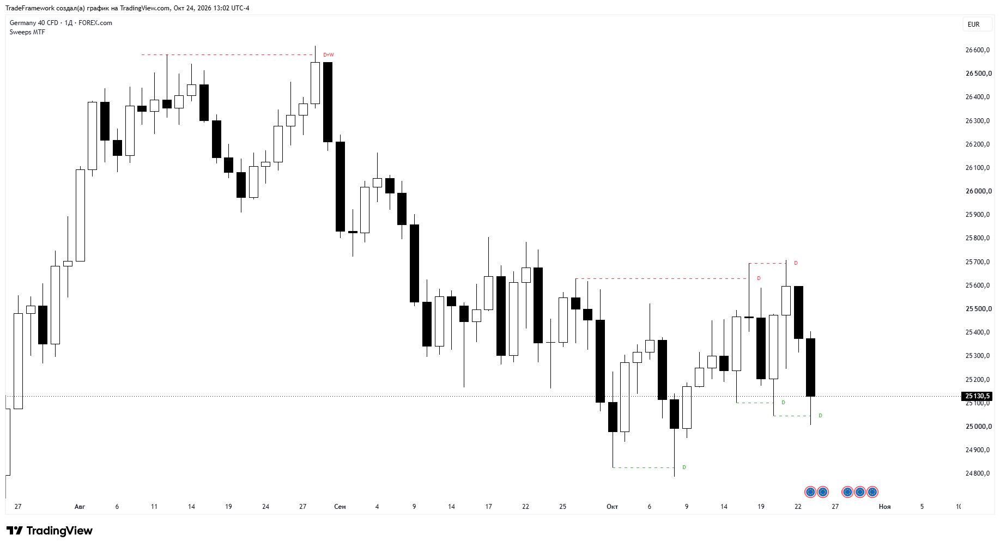
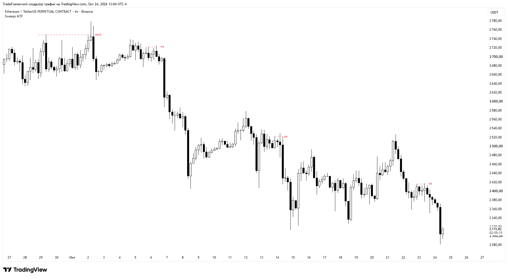
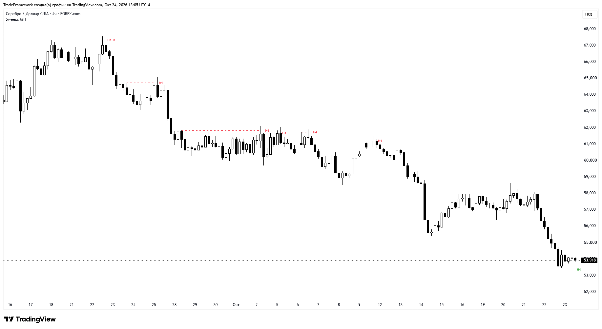

# Liquidity Sweeps MTF

**Multi-timeframe liquidity sweep detector for TradingView**

---

## 📸 Preview

  

### More examples

| Example 2 | Example 3 |
|:---:|:---:|
|  |  |

*Screenshots are illustrations of how the indicator draws sweeps, not a guarantee of results.*

---

## 🔎 What it does

The indicator finds swing highs and swing lows on higher timeframes and keeps them as liquidity levels. When price wicks through a level and then closes back on the other side, the level is marked as **swept**: a line is drawn from the swing to the sweeping candle and labeled with the timeframe that owns the level.

- 🟢 **Bullish sweep:** a swing low is taken out and the candle closes back above it.
- 🔴 **Bearish sweep:** a swing high is taken out and the candle closes back below it.

## ✨ Features

- **Two independent liquidity sources.** Each has its own timeframe, detection depth and line style (defaults: Daily and H4).
- **Flexible timeframe modes.** Auto, Select TF, or X+1, X+2, X+3 steps above the chart timeframe.
- **Three detection depths.** Short, Intermediate and Long Term swings.
- **Level merging.** Levels from different timeframes within a set number of ticks become one line with one combined label, for example `Sweep H1+H4`.
- **One line per candle.** If a single candle sweeps several levels, only the extreme one is drawn (the highest for highs, the lowest for lows).
- **Invalidation modes.** A level is removed when a candle *closes* beyond it, or when the candle *body* goes beyond it.
- **Clean chart.** Invalidated and expired levels are erased completely, including their labels.
- Calculated on confirmed bars, so lines do not flicker on the live candle.

## ⚙️ Settings

### General

| Setting | Default | Description |
|---|---|---|
| Invalidate sweep by | Close | `Close`: a level is removed if a candle closes beyond it. `Body`: removed if the candle body goes beyond it |
| Max level age (bars) | 5000 | Levels older than this are removed |
| Label text | Sweep | Base text of the labels |
| Merge levels within (ticks) | 1.0 | Levels closer than this are treated as one |

### Style

| Setting | Default | Description |
|---|---|---|
| Bullish sweep (low swept) | `#089981` | Color of bullish sweeps |
| Bearish sweep (high swept) | `#f23645` | Color of bearish sweeps |

### Liquidity 1 and Liquidity 2

| Setting | Liquidity 1 | Liquidity 2 | Description |
|---|---|---|---|
| Show | on | on | Enable the source |
| Mode | Select TF | Select TF | Auto, Select TF, X+1 TF, X+2 TF, X+3 TF |
| Timeframe | D | 240 | Used in Select TF mode |
| Detection | Intermediate Term | Intermediate Term | Short, Intermediate or Long Term swings |
| Line style | Solid | Dashed | Solid, Dashed or Dotted |

> If a selected timeframe is lower than the chart timeframe, the chart timeframe is used instead.

## 🚀 Installation

1. Open any chart on [TradingView](https://www.tradingview.com/).
2. Open the **Pine Editor** at the bottom of the screen.
3. Copy the contents of the `.pine` file from this repository into the editor.
4. Click **Add to chart**.

## 📝 Notes

- The indicator can draw up to 500 lines and 500 labels.
- Sweeps are evaluated at bar close.
- This is a charting tool. It does not predict price and is not financial advice.

## 📄 License

**© 2026 Meta Program Labs. All rights reserved.**

The source code is open for viewing and for personal, non-commercial use on your own TradingView account. Copying, modification, redistribution, republishing and commercial use require written permission. See [LICENSE](LICENSE) for details.

## 📬 Author

**Meta Program Labs**

---

<b>🇷🇺 На русском</b>

 

### Liquidity Sweeps MTF

Индикатор для TradingView, который находит свинг-хаи и свинг-лоу на старших таймфреймах как уровни ликвидности и отмечает их **снятие**: цена прокалывает уровень тенью и закрывается обратно.

- 🟢 **Бычье снятие:** выбит свинг-лоу, свеча закрылась выше него.
- 🔴 **Медвежье снятие:** выбит свинг-хай, свеча закрылась ниже него.

**Возможности:** два независимых источника ликвидности со своими таймфреймами, режимы Auto / Select TF / X+1..X+3, три глубины поиска свингов, объединение близких уровней разных таймфреймов в одну линию (например `Sweep H1+H4`), одна линия на свечу, отмена уровня по закрытию или по телу свечи, автоматическая очистка графика.

**Установка:** откройте Pine Editor в TradingView, вставьте код из `.pine` файла и нажмите Add to chart.

**Лицензия:** © 2026 Meta Program Labs, все права защищены. Код открыт для просмотра и личного некоммерческого использования на своём аккаунте TradingView. Копирование, изменение, распространение и коммерческое использование без письменного разрешения запрещены.

**Автор:** [Telegram-канал](https://t.me/Metaprogramlabs)

